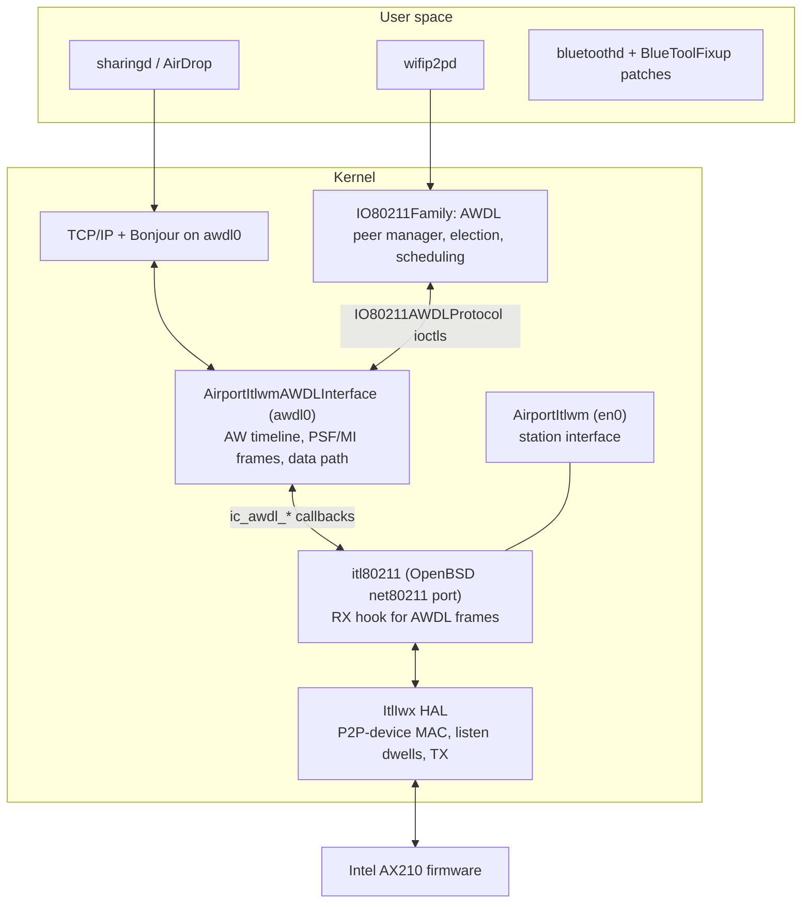

# How AWDL works in this driver

AirDrop needs three things from the Mac:

1. **BLE advertising**, so nearby iPhones know an AirDrop-capable device is around. That is Bluetooth: `bluetoothd` plus BlueToolFixup's advertising-sets patch for non-Apple controllers.
2. **AWDL** (Apple Wireless Direct Link), a peer-to-peer Wi-Fi link that runs next to the normal Wi-Fi connection. Devices meet on agreed channels in short, synchronized time slots called availability windows (AW).
3. **IP over AWDL**: Bonjour finds `_airdrop._tcp` on `awdl0`, then the phone opens a TCP/TLS connection to port 8770 and runs the AirDrop HTTP exchange (DISCOVER, ASK, UPLOAD).

On a real Mac the Broadcom firmware does most of the AWDL timing. The Intel firmware knows nothing about AWDL, so this driver does that work on the host.

## The layers

| Layer | Files | Role |
|---|---|---|
| IO80211Family (Apple) | in macOS | Owns AWDL: peer manager, master election, channel sequence, service discovery. It talks to the driver through the `IO80211AWDLProtocol` interface, the same one Apple's Broadcom driver implements. |
| `AirportItlwmAWDLInterface` | `driver/AirportItlwm/AirportItlwm/AirportItlwmAWDLInterface.{hpp,cpp}` | Our implementation of `IO80211AWDLProtocol`. Answers the AWDL ioctls, keeps the AW timeline on the host, builds and sends the periodic sync frames (PSF) and master indication frames (MI), and moves data frames between `awdl0` and the radio. |
| `AirportItlwmV2` / Skywalk interface | `AirportItlwmV2.cpp`, `AirportItlwmSkywalkInterface.cpp` | Announce the AWDL capability (only with `-itlawdl`) and create `awdl0` when IO80211Family asks for it (`VIRTUAL_IF_CREATE`). |
| net80211 hook | `itl80211/openbsd/net80211/ieee80211_input.c`, `ieee80211_var.h` | Diverts AWDL action frames (vendor-specific, Apple OUI) and AWDL data frames, unicast and group-addressed, to `awdl0` before the station code drops them as foreign BSS traffic. |
| HAL | `itlwm/hal_iwx/ItlIwx.cpp`, `if_iwxvar.h`, `if_iwxreg.h` | Turns "listen on channel X for N TU" and "send this frame now" into Intel firmware commands. |

## The HAL interface (what a new chip has to provide)

The AWDL code above the HAL only uses a handful of callbacks and fields in `struct ieee80211com` (`ieee80211_var.h`). This is the contract a port to another chip must implement:

| Member | Direction | Meaning |
|---|---|---|
| `ic_awdl_listen(ic, chan, dwell_tu)` | AWDL → HAL | Go to `chan` for `dwell_tu` time units, even while associated elsewhere, and deliver what is heard there. |
| `ic_awdl_dwell_state(ic, &chan)` | AWDL → HAL | Is the dwell idle, requested, or actually running (and on which channel)? The TX pump polls this. |
| `ic_awdl_tx(ic, chan, frame, len)` | AWDL → HAL | Send one raw 802.11 frame now, on `chan`. Return `EAGAIN` if the radio is not on that channel at this moment. |
| `ic_vendor_action_handler(ic, m, ...)` | HAL → AWDL | A received vendor action frame (AWDL PSF/MI and friends). |
| `ic_awdl_data_handler(ic, m, ...)` | HAL → AWDL | A received AWDL data frame for `awdl0` (takes ownership of the mbuf). |
| `ic_awdl_addr`, `ic_awdl_bssid`, `ic_awdl_addr_gen` | AWDL → HAL | The MAC address of `awdl0` and the AWDL BSSID. The HAL must receive and ACK frames sent to `ic_awdl_addr`. |
| `ic_awdl_want_data` | AWDL → HAL | An AWDL peer is active: let data frames for `ic_awdl_addr` through (on Intel: `IN_PROMISC` on the P2P MAC). |
| counters (`ic_awdl_roc_*`, `ic_awdl_tx_*`, ...) | HAL → AWDL | Diagnostics shown in `ioreg` and `awdlctl show`. Optional but very useful. |

[porting-to-other-wifi-chips.md](porting-to-other-wifi-chips.md) explains how to implement these on different hardware.

## How the Intel firmware is used

- **Listening.** Three methods were tried: auxiliary remain-on-channel (`HOT_SPOT_CMD`), scan-based dwells, and a **P2P-device MAC**. Only the last one works while the station is associated. It copies what Linux `iwlmvm` does for a P2P device: a second MAC context bound to its own PHY context, a broadcast station with a TX queue, and `SESSION_PROTECTION_CMD` to stay on the channel. Enabled by `-itlawdlp2p`.
- **Receiving data.** That P2P MAC delivers only management frames unless `IN_PROMISC` is set. With `-itlawdlpromisc` the driver sets it while an AWDL peer is active, so the firmware delivers and ACKs data addressed to `awdl0`.
- **Transmitting.** Frames go out on the P2P MAC's queue, and only while the dwell is actually running on the right channel. The firmware starts a dwell with a variable delay (2 to 75 ms in our measurements), so the **TX pump** (`-itlawdltxpump`) polls the dwell state every millisecond and sends as soon as it starts, instead of at fixed offsets. That change moved most data frames from "> 1 s queued" to "< 5 ms". Details: [research/awdl-tx-timing.md](research/awdl-tx-timing.md).

## The availability-window timeline

AWDL devices agree on a timeline: a sequence of 16 slots, each one AW-period long, each assigned to a channel (for example `149 0 0 0 6 0 ...`, where 0 means "not on AWDL"). The elected **master** defines the timeline and everyone else synchronizes to it from the PSF/MI frames.

The driver keeps this timeline in host microseconds (`AirportItlwmAWDLInterface`, "Host-side availability window timeline"). Before each slot where AWDL is on a channel, it requests a listen dwell `itlawdllead` microseconds early, transmits PSF/MI and queued data during the dwell, and tracks when it last heard each peer (IO80211Family drops a peer after about 6 s of silence).

Two problems found during testing, both fixed:

- **The Mac wins the election but the iPhone keeps its own timeline.** Then the Mac and the iPhone have few or no common slots in low-power mode and the AirDrop upload never arrives. `-itlawdlfollow` makes the Mac adopt the peer's timeline in that case. See [research/airdrop-master-election-and-multicast.md](research/airdrop-master-election-and-multicast.md).
- **Multicast never reached `awdl0`.** The net80211 hook only accepted frames addressed to `awdl0`'s MAC, so mDNS queries from the iPhone were dropped and the Mac only reappeared in the AirDrop list when Bonjour re-announced by itself (40+ s). Group-addressed AWDL data with the AWDL BSSID is now delivered to `awdl0`.

## Sequoia vs Tahoe

The AWDL logic is the same for both. What differs is the IO80211Family ABI: class layouts, vtable slot offsets, and whether some objects have virtual methods at all. `driver/AirportItlwm/AirportItlwm/AirportItlwmAWDLConfig.h` picks the ABI at compile time (`AIRPORT_AWDL_ABI_SEQUOIA` or `AIRPORT_AWDL_ABI_TAHOE`), and the version shims in `include/Airport/` select the matching headers. The full list of ABI-dependent places is in [research/awdl-sequoia-port-analysis.md](research/awdl-sequoia-port-analysis.md).

## BLE advertising sets

Without advertising sets, `bluetoothd` refuses to run the BLE advertising AirDrop and Handoff need when the controller is not an Apple one. BlueToolFixup patches `bluetoothd` in memory as its pages are loaded. On macOS 15.8.1 the patch table is applied only if the `bluetoothd` binary's UUID matches the one the patterns were verified against; otherwise nothing is patched. Details: [research/ble-advsets-analysis.md](research/ble-advsets-analysis.md) and [research/ble-advsets-sequoia-changes.md](research/ble-advsets-sequoia-changes.md).

## Further reading

- Milan Stute et al., *One Billion Apples' Secret Sauce: Recipe for the Apple Wireless Direct Link Ad hoc Protocol* (MobiCom 2018), and the [Open Wireless Link](https://owlink.org/) project: the public description of AWDL frames, election and synchronization.
- Linux `iwlmvm` P2P-device code (`drivers/net/wireless/intel/iwlwifi/mvm/`), for the firmware commands used by the listen path.
